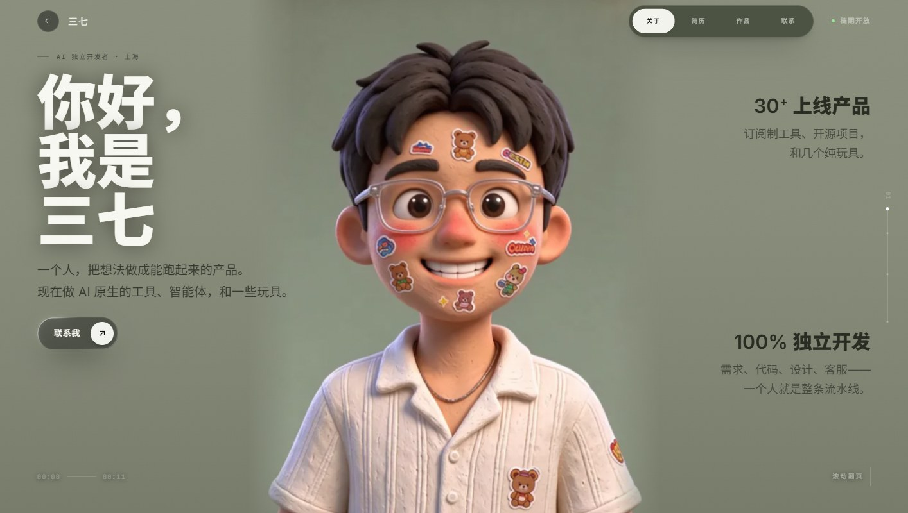

# 三七 · Portfolio

[中文](README.md) ｜ **English**

A one-person developer homepage — four pages stitched together by an 11-second claymation short: turn the wheel, the film scrubs frame by frame, and on the first screen the character turns his head to follow your cursor.

🔗 **Live: https://SANQI-AICreator.github.io/portfolio/**



---

## What this is

A single-page portfolio in **plain HTML + CSS + JavaScript** — no framework, no build step, no external dependencies (fonts, video and images are all local). Everything lives in one `index.html`, about 163 KB.

Four pages:

| # | Page | Contents |
|---|---|---|
| 01 | About | Editorial headline, two stat blocks, CTA |
| 02 | Résumé | Glass card that flips — summary on the front, full history on the back |
| 03 | Work | 3D depth carousel, five projects, click to expand |
| 04 | Contact | Same three-zone grid as the hero, email copied with one click |

## How it works

**Page turning**　Not native scrolling — a deck model: one wheel notch, arrow key or vertical swipe equals one page. The background film is scrubbed by setting `currentTime` (re-encoded all-intra, so it can jump to any frame instantly), while the copy layer fades upward.

**Hero gaze**　The pointer is converted into a vector relative to the character's face, then mapped by angle onto a 264-frame head-turn clip (`assets/gaze2/`). A ring of keyframes interpolates the right timestamp, which is drawn to a canvas. When the cursor stops, he holds that pose — no idle drift.

**Résumé card**　Click or drag sideways to flip; the spring is hand-rolled (`k=170 / c=20`), with a subtle tilt and glare on hover. `Enter` / `Space` work too.

**Work carousel**　Each card's `translateZ`, `rotateY`, brightness and blur come from a ring-position table, producing a radial depth queue. Drag, arrows, dots and horizontal wheel all advance it; 4.5 s autoplay pauses on hover or when a project is open.

**Details**　The pill nav dissolves between items via SDF contour clipping; the CTA button is a WebGL2 rim light; the cursor is a neon arrow; email and contact rows copy to clipboard.

## Accessibility & compatibility

- `prefers-reduced-motion: reduce` disables flips, tilt and spring motion, keeping only fades
- Video is `muted` + `playsinline`, so iOS Safari never goes fullscreen
- On touch devices the custom cursor is not loaded and pages 02–03 become bottom sheets
- Semantic markup with `aria-pressed` / `aria-hidden` / `role`; fully keyboard operable

## Layout

```
.
├── index.html          # all styles and scripts (single file)
├── assets/
│   ├── hero-1080.mp4   # hero film, 1920×1080, 11.03 s, all-intra, 22 MB
│   ├── hero-720.mp4    # mobile variant, 1280 wide, 7 MB
│   ├── gaze2/          # 264 head-turn frames (576×720 webp, 7.7 MB)
│   ├── fonts/          # Anton + Inter + JetBrains Mono + Noto Sans SC (subset)
│   ├── resume.webp     # résumé-page character
│   ├── work.webp       # work-page character
│   ├── work-1…5.webp   # project artwork
│   └── poster.jpg      # first frame of the video
├── preview/            # screenshots (not deployed)
├── build-dist.py       # bundles into dist/
└── deploy.ps1          # bundle + commit + push
```

## Local preview

Every path is relative, so opening `index.html` directly mostly works, but serving it is safer:

```bash
cd code文件
python -m http.server 8088
# open http://127.0.0.1:8088/
```

## Deploy

Push to publish. `dist/` is its own git repository whose `main` root is the site root.

```powershell
# after editing index.html
pwsh -File deploy.ps1 "tweak the hero copy"
```

`deploy.ps1` rebuilds `dist/` with `build-dist.py` (injecting favicon, OG tags, `.nojekyll` and a 404 fallback), commits, and pushes. GitHub Pages rebuilds in 30–60 s.

## Performance

First visit is roughly **250 requests / 30 MB**, of which the hero film is 22 MB. Everything is cached afterwards.

To slim it down: re-encode the film at 1080p / CRF 26 (~12 MB) and lazy-load the gaze frames while dropping duplicates — about 13 MB on first visit, with the same scrubbing feel (still all-intra).

## Notes

- The character film and illustrations were generated with 即梦 AI and post-processed; project artwork is AI-generated too
- Typefaces: Anton, Inter, JetBrains Mono (SIL OFL); the Chinese face is a Noto Sans SC subset
- Interaction references: React Bits' FlipCard / DepthCarousel / GooeyNav / SpecularButton / CardSwap — all rewritten in vanilla JS here, with no React and no gsap

© 2025 三七 — Shanghai
